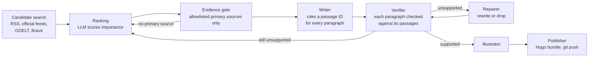

# Weary.ai

[](https://github.com/elizaibeth/weary-ai/actions/workflows/site.yml)
[](https://github.com/elizaibeth/weary-ai/actions/workflows/daily.yml)
[](https://github.com/elizaibeth/weary-ai/actions/workflows/evals.yml)

[](pipeline/pyproject.toml)
[](https://github.com/astral-sh/uv)
[](https://github.com/astral-sh/ruff)
[](https://mypy-lang.org/)
[](.pre-commit-config.yaml)
[](.pre-commit-config.yaml)
[](.github/dependabot.yml)
[](LICENSE)

Live at [weary.ai](https://weary.ai/).

[](https://weary.ai/)

Weary is an AI news site that runs without a human editor. Once a day, a scheduled job picks the most important AI story, reads the primary sources, writes a short article and checks each paragraph against those sources before publishing it.

Most of the code exists to stop the model from stating things that the sources do not support.

## How it works



1. **Find stories.** The pipeline reads about 40 feeds from AI labs, government sites and security advisories. Outlets such as TechCrunch and WIRED supply leads only (`research/discovery.py`).
2. **Rank them.** Headlines about the same event are merged. A model scores them twice in different orders, to cancel position bias, and anything it makes up is thrown out. Stories with no AI angle are dropped, by the prompt and again in code. Stories are tried in order of `importance − cost / p(verifies)`, where `p` comes from past runs (`research/ranking.py`).
3. **Get evidence.** Only pages from the organisation that made the news count as evidence, such as the company, agency or court. A story without a primary source is skipped (`evidence/source_rules.toml`).
4. **Write.** The model gets numbered passages and has to cite one for every paragraph (`writing/writer.py`).
5. **Check.** TypeSafe, a separate fact-checking service, checks each paragraph against only the passages it cites (`checking/verifier.py`).
6. **Fix or move on.** Failing paragraphs are rewritten or cut and checked again. If it still fails, the next story is tried (`checking/repairer.py`).
7. **Publish.** Model text is escaped so it can't add links or HTML. Anything not fully verified is saved as a draft (`publishing/publisher.py`).

On Saturdays, the site publishes an opinion column on the week's news. On Sundays, it publishes the research paper of the week, chosen from Hugging Face Daily Papers.

## Prompt injection

Headlines and source pages come from the open web, so any of them could contain instructions such as "ignore your previous instructions". The pipeline does not try to detect this. Instead, it makes sure that an injection cannot change what is published, even if the model follows it:

- The ranking can only reorder real headlines. Made-up URLs or headlines are dropped.
- A headline can't fake the `[official source]` tag.
- Only allowlisted sources count as evidence.
- The checker is a different service from the writer, so an injection has to fool both.
- Anything that fails a check stays a draft.

The tests in [`pipeline/tests/security/`](pipeline/tests/security/test_prompt_injection.py) give a model hostile headlines, let it obey them, and check nothing gets through. More in [`docs/security/`](docs/security/README.md).

## Other decisions

- **The ranking is measured.** It's scored against 20 past days with graded labels. Making the prompt AI-only cut the days that led with an off-topic story from 58% to none, and raised the share that led with the best story from 22% to 50%. You can rerun it without an API key ([`pipeline/evals/`](pipeline/evals/README.md)).
- **Failure is handled.** If no story can be verified, nothing is published and a Slack message explains why. Invalid keys or billing errors stop the run immediately.
- **Costs are capped.** Images are generated only for the final article, search has per-run, per-day and per-month budgets, and each run posts its cost to Slack.
- **Provider fallback.** Failed calls are retried, and if the main model is unavailable, the pipeline switches to a model from another provider.
- **Testable design.** Each model step has a pure function that builds the prompt and checks the reply, and a thin wrapper that makes the call. The whole pipeline runs in tests against fake services.

Write-ups of the main decisions are in [`docs/adr/`](docs/adr/README.md).

## Services

| Service | What for | Setting |
|---|---|---|
| [Runware](https://runware.ai/) | Text models (GPT-5.4 mini, GPT-5.5 for opinion, Gemini Flash Lite fallback) and images | `RUNWARE_API_KEY` (required) |
| TypeSafe (`typesafe-sdk`) | Fact-checking each paragraph | `TYPESAFE_API_KEY` (required) |
| Brave Search | Finding primary sources and old headlines for backfills | `BRAVE_SEARCH_API_KEY` (optional) |
| GDELT, Hugging Face, RSS | Story and paper candidates | free, no key |
| Slack | Run results and costs | `SLACK_WEBHOOK_URL` (optional) |
| GitHub Actions | Daily run at 13:07 UTC, weekly eval, CI | repo secrets |
| Railway | Hosting (Hugo + Caddy in Docker) | deploys from `main` |

Settings are in [`pipeline/.env.example`](pipeline/.env.example), the feed list is in [`discovery.py`](pipeline/agent/research/discovery.py) and the source allowlist is in [`source_rules.toml`](pipeline/agent/evidence/source_rules.toml).

Built with Python 3.11, uv, Hugo, pytest (370+ tests, 94% coverage), ruff, mypy, pip-audit, gitleaks and Dependabot.

## Repository layout

```text
pipeline/agent/      the newsroom pipeline: daily.py runs these stages in order
  research/          candidate search and ranking
  evidence/          primary sources, the allowlist and passage selection
  writing/           prompts, the writer and draft validation
  checking/          claim verification and repair
  publishing/        cover image, Hugo page, Slack alerts, archive
  services/          HTTP, the text-model client and run costs
pipeline/tests/      unit and integration tests, all offline, in the same folders (security/: prompt injection)
pipeline/evals/      ranking evaluation: gold set (TREC qrels), metrics, saved replies, variant comparison
pipeline/runs/       one JSON record per daily run: ranking, candidates tried, outcome
content/posts/       published editions (committed by the daily job)
layouts/, static/    Hugo theme
docs/                design notes, security (threat model), adr (decision records)
.github/workflows/   daily edition, weekly ranking eval and CI checks
```

## Running locally

Requirements: [uv](https://docs.astral.sh/uv/) and, to preview the site, [Hugo](https://gohugo.io/) extended 0.160 or later.

```sh
cd pipeline
uv sync --locked
cp .env.example .env           # add RUNWARE_API_KEY and TYPESAFE_API_KEY
uv run pytest -q               # no keys or network needed

uv run python -m agent --local                        # today's edition, saved as a local draft
uv run python -m agent --local --date 2026-10-21      # backfill a specific day
uv run python -m agent --local --url https://...      # write up one chosen article
```

`--local` saves a draft and turns off Slack, paid images and most search requests. Preview the site with `hugo server -D` from the repository root. `python -m agent.source_check` shows which feeds this machine can reach.

## How this was built

I designed the project and built it with AI coding agents. Their rules are in [`AGENTS.md`](AGENTS.md), and [`CONTRIBUTING.md`](CONTRIBUTING.md) has the commit conventions.

## Licence

[MIT](LICENSE).
